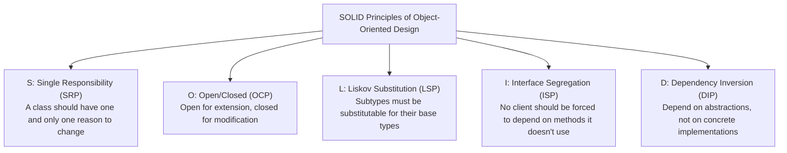

# Track 3: System Design — Low-Level Design (LLD)
## Chapter 1: SOLID Principles & Essential GoF Design Patterns

> 🧭 **Navigation**: [⬅️ Previous: HLD 05: Twitter News Feed](../hld/05-twitter-news-feed-system.md) | [🏠 System Design Track Index](../README.md) | [➡️ Next: LLD 02: Parking Lot System](02-parking-lot-system.md)

---

In Low-Level Design (LLD) interviews (also known as Object-Oriented Design or Machine Coding), interviewers assess your ability to write modular, extensible, maintainable, and testable code. They look for strict adherence to SOLID principles, thoughtful application of Design Patterns, and thread-safe implementation.

---

### Real-World Production Context
- **Spring Framework (Dependency Injection)**: Spring extensively uses the Dependency Inversion Principle. Instead of objects creating their own dependencies, the Spring IoC (Inversion of Control) container injects them at runtime. This makes components highly testable and decoupled.
- **Django ORM (Active Record / Repository)**: Django uses the Active Record pattern where classes map directly to database tables, and instances map to rows. While Active Record can sometimes violate Single Responsibility, modern Django applications often layer it with the Repository pattern to separate business logic from data access.

---

> 💡 **Interview Tip**
> Don't just memorize the SOLID acronyms. Interviewers will give you intentionally poorly designed code (e.g., a "God Class") and ask you to refactor it. Be prepared to explain exactly *why* your refactored design is better—focusing on testability and ease of adding new features.

---

### 1. The SOLID Principles with Practical Implementations



#### 1. Single Responsibility Principle (SRP)
- **Anti-Pattern**: An `Invoice` class that calculates totals, formats HTML, and executes SQL inserts to save to the database.
- **Refactoring**:
  - `Invoice`: Holds line items and computes financial totals.
  - `InvoiceRepository`: Handles database persistence.
  - `InvoiceRenderer`: Handles HTML/PDF presentation.

#### 2. Open/Closed Principle (OCP)
Classes should be open for extension, but closed for modification.

**Python 3 Example:**
```python
# ✅ Open/Closed: Easily add new discount types without modifying existing classes
from abc import ABC, abstractmethod

class DiscountStrategy(ABC):
    @abstractmethod
    def apply_discount(self, amount: float) -> float:
        pass

class FlatDiscount(DiscountStrategy):
    def __init__(self, discount: float):
        self.discount = discount

    def apply_discount(self, amount: float) -> float:
        return max(0.0, amount - self.discount)

class PercentageDiscount(DiscountStrategy):
    def __init__(self, percentage: float):
        self.percentage = percentage

    def apply_discount(self, amount: float) -> float:
        return amount * (1.0 - self.percentage / 100.0)
```

**Java 17 Example:**
```java
public interface DiscountStrategy {
    double applyDiscount(double amount);
}

public class FlatDiscount implements DiscountStrategy {
    private final double discount;
    
    public FlatDiscount(double discount) {
        this.discount = discount;
    }
    
    @Override
    public double applyDiscount(double amount) {
        return Math.max(0.0, amount - discount);
    }
}

public class PercentageDiscount implements DiscountStrategy {
    private final double percentage;
    
    public PercentageDiscount(double percentage) {
        this.percentage = percentage;
    }
    
    @Override
    public double applyDiscount(double amount) {
        return amount * (1.0 - percentage / 100.0);
    }
}
```

#### 3. Liskov Substitution Principle (LSP)
Objects of a superclass should be replaceable with objects of its subclasses without breaking application correctness.
- **Classic Violation**: `Square` inheriting from `Rectangle`. Changing the width of a `Square` modifies its height, violating assumptions made by code expecting a generic `Rectangle`.
- **Rule**: If a subclass throws `NotImplementedException` for an inherited method, LSP is violated.

#### 4. Interface Segregation Principle (ISP)
Clients should not be forced to depend upon interfaces they do not use. Split fat interfaces into smaller, cohesive interfaces.

**Python 3 Example:**
```python
# ✅ Good ISP: Discrete, role-based interfaces
class Printable(ABC):
    @abstractmethod
    def print_document(self):
        pass

class Scannable(ABC):
    @abstractmethod
    def scan_document(self):
        pass

class BasicPrinter(Printable):
    def print_document(self):
        print("Printing...")

class AllInOneOfficePrinter(Printable, Scannable):
    def print_document(self):
        print("Printing...")
    def scan_document(self):
        print("Scanning...")
```

**Java 17 Example:**
```java
public interface Printable {
    void printDocument();
}

public interface Scannable {
    void scanDocument();
}

public class BasicPrinter implements Printable {
    @Override
    public void printDocument() {
        System.out.println("Printing...");
    }
}

public class AllInOneOfficePrinter implements Printable, Scannable {
    @Override
    public void printDocument() {
        System.out.println("Printing...");
    }
    
    @Override
    public void scanDocument() {
        System.out.println("Scanning...");
    }
}
```

#### 5. Dependency Inversion Principle (DIP)
High-level modules should not depend on low-level modules; both should depend on abstractions.

**Python 3 Example:**
```python
# ✅ DIP: NotificationService depends on abstract MessageSender
class MessageSender(ABC):
    @abstractmethod
    def send(self, recipient: str, message: str):
        pass

class TwilioSMSSender(MessageSender):
    def send(self, recipient: str, message: str):
        print(f"Sending SMS via Twilio to {recipient}: {message}")

class NotificationService:
    def __init__(self, sender: MessageSender):
        self.sender = sender  # Injected abstraction

    def notify_user(self, user_id: str, message: str):
        self.sender.send(user_id, message)
```

**Java 17 Example:**
```java
public interface MessageSender {
    void send(String recipient, String message);
}

public class TwilioSmsSender implements MessageSender {
    @Override
    public void send(String recipient, String message) {
        System.out.println("Sending SMS via Twilio to " + recipient + ": " + message);
    }
}

public class NotificationService {
    private final MessageSender sender;
    
    public NotificationService(MessageSender sender) {
        this.sender = sender;
    }
    
    public void notifyUser(String userId, String message) {
        sender.send(userId, message);
    }
}
```

---

### 2. Must-Know GoF Design Patterns for LLD Interviews

#### 1. Strategy Pattern (Behavioral)
Defines a family of interchangeable algorithms and encapsulates each one inside a separate class.
- **When to use**: Dynamic payment options, pricing calculations, routing algorithms.

#### 2. Observer / Pub-Sub Pattern (Behavioral)
Defines a one-to-many dependency between objects so that when one object changes state, all its dependents are notified automatically.

**Python 3 Example:**
```python
class Observer(ABC):
    @abstractmethod
    def update(self, event_type: str, data: dict):
        pass

class Subject:
    def __init__(self):
        self._observers = []

    def attach(self, observer: Observer):
        self._observers.append(observer)

    def notify(self, event_type: str, data: dict):
        for observer in self._observers:
            observer.update(event_type, data)
```

**Java 17 Example:**
```java
import java.util.ArrayList;
import java.util.List;
import java.util.Map;

public interface Observer {
    void update(String eventType, Map<String, Object> data);
}

public class Subject {
    private final List<Observer> observers = new ArrayList<>();
    
    public void attach(Observer observer) {
        observers.add(observer);
    }
    
    public void notifyObservers(String eventType, Map<String, Object> data) {
        for (Observer observer : observers) {
            observer.update(eventType, data);
        }
    }
}
```

#### 3. Factory & Abstract Factory Pattern (Creational)
Decouples object creation from business logic.
- **Factory Method**: Creates instances of several derived classes based on input criteria.
- **Abstract Factory**: Creates families of related objects (e.g., UI themes: WindowsButton vs MacButton).

#### 4. Decorator Pattern (Structural)
Attaches additional responsibilities to an object dynamically without modifying its structure.

**Python 3 Example:**
```python
class Coffee(ABC):
    @abstractmethod
    def cost(self) -> float: pass

class SimpleCoffee(Coffee):
    def cost(self) -> float: return 5.0

class CoffeeDecorator(Coffee):
    def __init__(self, coffee: Coffee): self._coffee = coffee

class MilkDecorator(CoffeeDecorator):
    def cost(self) -> float: return self._coffee.cost() + 1.5
```

**Java 17 Example:**
```java
public interface Coffee {
    double cost();
}

public class SimpleCoffee implements Coffee {
    public double cost() { return 5.0; }
}

public abstract class CoffeeDecorator implements Coffee {
    protected final Coffee coffee;
    public CoffeeDecorator(Coffee coffee) { this.coffee = coffee; }
}

public class MilkDecorator extends CoffeeDecorator {
    public MilkDecorator(Coffee coffee) { super(coffee); }
    public double cost() { return coffee.cost() + 1.5; }
}
```

#### 5. State Pattern (Behavioral)
Allows an object to alter its behavior when its internal state changes. The object appears to change its class.
- **When to use**: Order lifecycle (`Created` $\to$ `Paid` $\to$ `Shipped`), Vending machine states.

---

> 📺 **Video References**
> - Concept&Coding / Workat.tech: Machine Coding SOLID Principles (https://www.youtube.com/@ConceptAndCoding)
> - NeetCode OOP Design Videos: https://www.youtube.com/@NeetCode

> 📖 **Must-Read Resources**
> - Martin Fowler's PoEAA: https://martinfowler.com/eaaCatalog/
> - Refactoring.guru Design Patterns: https://refactoring.guru/design-patterns
> - The System Design Primer: https://github.com/donnemartin/system-design-primer
> - LeetCode Design Problems: https://leetcode.com/tag/design/

---

> 🧭 **Navigation**: [⬅️ Previous: HLD 05: Twitter News Feed](../hld/05-twitter-news-feed-system.md) | [🏠 System Design Track Index](../README.md) | [➡️ Next: LLD 02: Parking Lot System](02-parking-lot-system.md)
