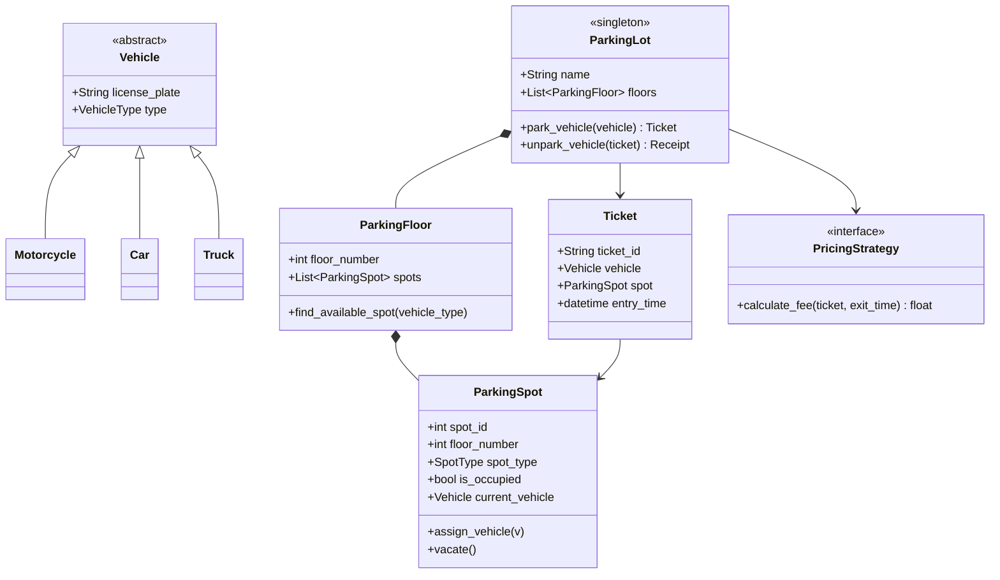

# Track 3: System Design — Low-Level Design (LLD)
## Chapter 2: Complete LLD: Object-Oriented Parking Lot System

The Parking Lot problem is the quintessential Low-Level Design interview question. It tests object-oriented modeling, polymorphism, state encapsulation, pricing strategy patterns, and thread safety.

---

### Real-World Production Context
- **ParkWhiz API / SpotHero Architecture**: Real multi-level parking systems deal with high concurrency (many cars trying to book the same spot simultaneously). They implement distributed locks and transactional databases to prevent double-booking. They also dynamically calculate rates using Strategy patterns (e.g., peak hours vs. standard hours).
- **Automated License Plate Readers (ALPR)**: Modern parking systems integrate with IoT devices. Instead of a human pressing a button, cameras act as the trigger. The software must handle state transitions asynchronously and handle edge cases like misread plates or unreadable tags.

---

> 💡 **Interview Tip**
> The main pitfalls here are ignoring concurrency and violating the Open/Closed Principle. Always use a `Strategy` pattern for pricing because prices change constantly. Also, explicitly mention locking mechanisms (like `threading.Lock()` or `ReentrantLock` in Java) when assigning a spot to demonstrate thread safety.

---

### 1. Requirements & Scope

#### Functional Requirements:
1. **Multi-Floor & Multi-Spot**: The parking lot contains multiple floors, each with designated spot types (`Compact`, `Regular`, `Large`, `Electric`).
2. **Vehicle Compatibility**:
   - `Motorcycle` $\to$ can park in `Compact`, `Regular`, or `Large`.
   - `Car` $\to$ can park in `Regular` or `Large`.
   - `Truck / Bus` $\to$ can park only in `Large`.
   - `Electric Car` $\to$ can park in `Electric` or `Regular`.
3. **Ticket Generation**: Emits a `Ticket` with entry timestamp, spot ID, and vehicle license plate on entry.
4. **Dynamic Fee Calculation**: Calculates parking fee on exit based on vehicle type and duration using a Strategy Pattern.
5. **Thread Safety**: Prevents race conditions where two vehicles are assigned the same spot concurrently.

---

### 2. Class Diagram



---

### 3. Implementations

#### Python 3 Implementation

```python
from abc import ABC, abstractmethod
from enum import Enum
from datetime import datetime
import threading
import uuid

# --- Enums ---
class VehicleType(Enum):
    MOTORCYCLE = 1; CAR = 2; TRUCK = 3; ELECTRIC = 4

class SpotType(Enum):
    COMPACT = 1; REGULAR = 2; LARGE = 3; ELECTRIC = 4

# --- Vehicle Hierarchy ---
class Vehicle(ABC):
    def __init__(self, license_plate: str, vehicle_type: VehicleType):
        self.license_plate = license_plate
        self.vehicle_type = vehicle_type

    @abstractmethod
    def can_fit_in_spot(self, spot_type: SpotType) -> bool:
        pass

class Car(Vehicle):
    def __init__(self, license_plate: str):
        super().__init__(license_plate, VehicleType.CAR)

    def can_fit_in_spot(self, spot_type: SpotType) -> bool:
        return spot_type in (SpotType.REGULAR, SpotType.LARGE)

# --- Thread-Safe Parking Spot ---
class ParkingSpot:
    def __init__(self, spot_id: int, floor_id: int, spot_type: SpotType):
        self.spot_id = spot_id
        self.floor_id = floor_id
        self.spot_type = spot_type
        self.is_occupied = False
        self.vehicle = None
        self._lock = threading.Lock()

    def assign_vehicle(self, vehicle: Vehicle) -> bool:
        with self._lock:
            if not self.is_occupied and vehicle.can_fit_in_spot(self.spot_type):
                self.vehicle = vehicle
                self.is_occupied = True
                return True
            return False

    def vacate(self):
        with self._lock:
            self.vehicle = None
            self.is_occupied = False

# --- Ticket & Pricing ---
class Ticket:
    def __init__(self, vehicle: Vehicle, spot: ParkingSpot):
        self.ticket_id = str(uuid.uuid4())[:8]
        self.vehicle = vehicle
        self.spot = spot
        self.entry_time = datetime.now()

class PricingStrategy(ABC):
    @abstractmethod
    def calculate(self, ticket: Ticket, exit_time: datetime) -> float: pass

class HourlyPricingStrategy(PricingStrategy):
    def calculate(self, ticket: Ticket, exit_time: datetime) -> float:
        duration_seconds = (exit_time - ticket.entry_time).total_seconds()
        hours = max(1, int((duration_seconds + 3599) // 3600))
        return hours * 20.0  # Simplified flat rate for example
```

#### Java 17 Implementation

```java
import java.util.concurrent.locks.ReentrantLock;
import java.time.LocalDateTime;
import java.time.Duration;
import java.util.UUID;

// --- Enums ---
enum VehicleType { MOTORCYCLE, CAR, TRUCK, ELECTRIC }
enum SpotType { COMPACT, REGULAR, LARGE, ELECTRIC }

// --- Vehicle Hierarchy ---
abstract class Vehicle {
    protected String licensePlate;
    protected VehicleType vehicleType;
    
    public Vehicle(String licensePlate, VehicleType type) {
        this.licensePlate = licensePlate;
        this.vehicleType = type;
    }
    public abstract boolean canFitInSpot(SpotType spotType);
}

class Car extends Vehicle {
    public Car(String licensePlate) {
        super(licensePlate, VehicleType.CAR);
    }
    @Override
    public boolean canFitInSpot(SpotType spotType) {
        return spotType == SpotType.REGULAR || spotType == SpotType.LARGE;
    }
}

// --- Thread-Safe Parking Spot ---
class ParkingSpot {
    private final int spotId;
    private final int floorId;
    private final SpotType spotType;
    private boolean isOccupied;
    private Vehicle vehicle;
    private final ReentrantLock lock = new ReentrantLock();

    public ParkingSpot(int spotId, int floorId, SpotType spotType) {
        this.spotId = spotId;
        this.floorId = floorId;
        this.spotType = spotType;
        this.isOccupied = false;
    }

    public boolean assignVehicle(Vehicle vehicle) {
        lock.lock();
        try {
            if (!isOccupied && vehicle.canFitInSpot(spotType)) {
                this.vehicle = vehicle;
                this.isOccupied = true;
                return true;
            }
            return false;
        } finally {
            lock.unlock();
        }
    }

    public void vacate() {
        lock.lock();
        try {
            this.vehicle = null;
            this.isOccupied = false;
        } finally {
            lock.unlock();
        }
    }
}

// --- Ticket & Pricing ---
class Ticket {
    public final String ticketId;
    public final Vehicle vehicle;
    public final ParkingSpot spot;
    public final LocalDateTime entryTime;

    public Ticket(Vehicle vehicle, ParkingSpot spot) {
        this.ticketId = UUID.randomUUID().toString().substring(0, 8);
        this.vehicle = vehicle;
        this.spot = spot;
        this.entryTime = LocalDateTime.now();
    }
}

interface PricingStrategy {
    double calculate(Ticket ticket, LocalDateTime exitTime);
}

class HourlyPricingStrategy implements PricingStrategy {
    @Override
    public double calculate(Ticket ticket, LocalDateTime exitTime) {
        long durationSeconds = Duration.between(ticket.entryTime, exitTime).getSeconds();
        long hours = Math.max(1, (durationSeconds + 3599) / 3600);
        return hours * 20.0; // Simplified flat rate
    }
}
```

---

> 📺 **Video References**
> - Concept&Coding: Design a Parking Lot (https://www.youtube.com/@ConceptAndCoding)
> - Udit Agarwal: LLD of Parking Lot (https://www.youtube.com/@UditAgarwal)

> 📖 **Must-Read Resources**
> - Martin Fowler's PoEAA: https://martinfowler.com/eaaCatalog/
> - Refactoring.guru Design Patterns: https://refactoring.guru/design-patterns
> - The System Design Primer: https://github.com/donnemartin/system-design-primer
> - LeetCode Design Problems: https://leetcode.com/tag/design/
