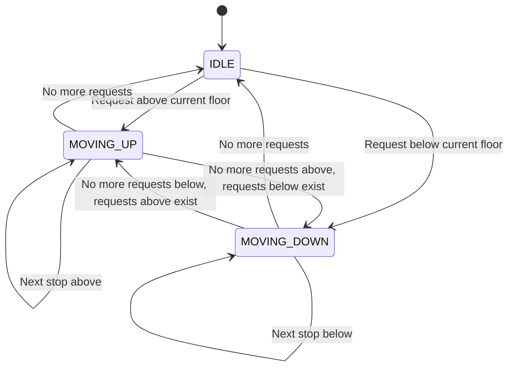
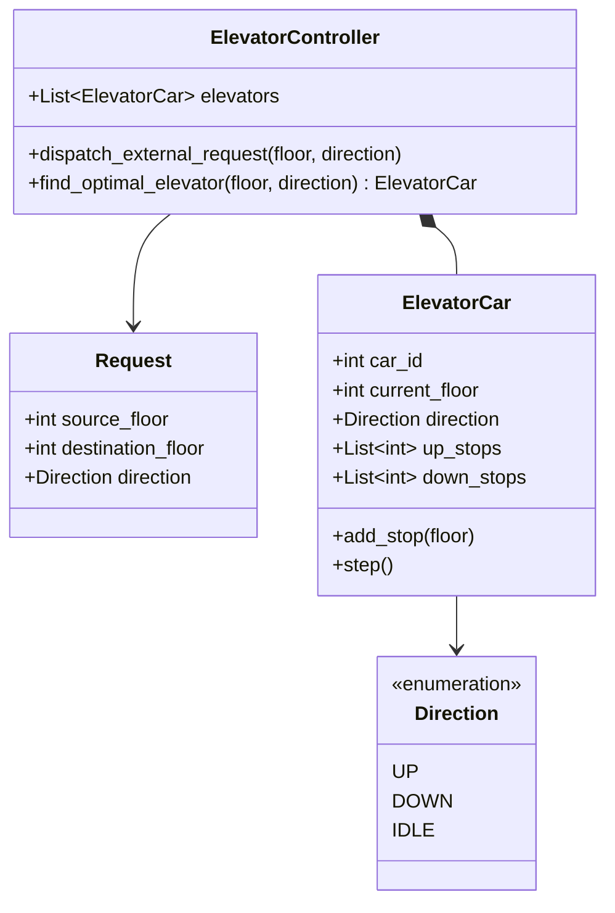

# Track 3: System Design — Low-Level Design (LLD)
## Chapter 3: Complete LLD: Multi-Elevator System & Dispatch Algorithms

The Elevator System design tests state machine modeling, concurrency, priority queues, and scheduling algorithms (SCAN / LOOK algorithm).

---

### Real-World Production Context
- **ThyssenKrupp TWIN System**: Real-world modern elevators don't just use simple SCAN/LOOK. Advanced systems assign passengers to cars before they even enter (Destination Dispatch) to minimize wait times and group people going to the same floor.
- **Otis CompassPlus**: Uses intelligent dispatching algorithms that take into account predictive traffic patterns (e.g., morning up-peak vs. evening down-peak).

> 💡 **Interview Tip**
> The biggest mistake candidates make is trying to optimize the algorithm perfectly. The interviewer wants to see your **state management** and **concurrency** handling. Stick to the SCAN/LOOK algorithm and ensure you model the `Direction` and `State` clearly.

---

### 1. Requirements & Algorithms

#### Functional Requirements:
1. **Building Scale**: $N$ floors and $M$ elevator cars operating in parallel.
2. **Request Sources**:
   - **External Request (Hall Call)**: Passenger at Floor $X$ presses `UP` or `DOWN`.
   - **Internal Request (Car Call)**: Passenger inside Elevator $E$ presses Destination Floor $Y$.
3. **Elevator States**: `IDLE`, `MOVING_UP`, `MOVING_DOWN`. Door states: `OPEN`, `CLOSED`.
4. **Dispatching Algorithm**:
   - **LOOK Algorithm (Elevator Algorithm)**: The elevator continues traveling in its current direction, servicing all pending requests along the way, until there are no further requests in that direction. Only then does it reverse direction.



---

### 2. Class Diagram



---

### 3. Production Python Implementation (LOOK Algorithm)

```python
from enum import Enum
import heapq

class Direction(Enum):
    UP = 1
    DOWN = -1
    IDLE = 0

class ElevatorCar:
    def __init__(self, car_id: int, current_floor: int = 1):
        self.car_id = car_id
        self.current_floor = current_floor
        self.direction = Direction.IDLE
        # Priority queues / sets for stops
        self.up_stops: list[int] = []    # Min-heap for UP requests
        self.down_stops: list[int] = []  # Max-heap (simulated with negative values) for DOWN requests
        self.door_open = False

    def add_destination(self, target_floor: int):
        if target_floor > self.current_floor:
            if target_floor not in self.up_stops:
                heapq.heappush(self.up_stops, target_floor)
            if self.direction == Direction.IDLE:
                self.direction = Direction.UP
        elif target_floor < self.current_floor:
            neg_floor = -target_floor
            if neg_floor not in self.down_stops:
                heapq.heappush(self.down_stops, neg_floor)
            if self.direction == Direction.IDLE:
                self.direction = Direction.DOWN
        else:
            self._open_and_close_doors()

    def step(self):
        """Simulates one clock cycle / movement step of the elevator."""
        if self.direction == Direction.UP:
            if self.up_stops:
                next_stop = self.up_stops[0]
                self.current_floor += 1
                print(f"[Elevator {self.car_id}] Moving UP -> Reached Floor {self.current_floor}")
                if self.current_floor == next_stop:
                    heapq.heappop(self.up_stops)
                    self._open_and_close_doors()
            
            # Transition condition
            if not self.up_stops:
                if self.down_stops:
                    self.direction = Direction.DOWN
                else:
                    self.direction = Direction.IDLE

        elif self.direction == Direction.DOWN:
            if self.down_stops:
                next_stop = -self.down_stops[0]
                self.current_floor -= 1
                print(f"[Elevator {self.car_id}] Moving DOWN -> Reached Floor {self.current_floor}")
                if self.current_floor == next_stop:
                    heapq.heappop(self.down_stops)
                    self._open_and_close_doors()
            
            # Transition condition
            if not self.down_stops:
                if self.up_stops:
                    self.direction = Direction.UP
                else:
                    self.direction = Direction.IDLE

    def _open_and_close_doors(self):
        self.door_open = True
        print(f"  --> [Elevator {self.car_id}] Doors OPENED at Floor {self.current_floor}. Passengers embark/disembark. Doors CLOSED.")
        self.door_open = False

    def calculate_distance_penalty(self, floor: int, direction: Direction) -> int:
        """Heuristic score to pick the best car: lower score = better fit."""
        if self.direction == Direction.IDLE:
            return abs(self.current_floor - floor)
        
        if self.direction == Direction.UP and direction == Direction.UP:
            if floor >= self.current_floor:
                return floor - self.current_floor  # On the way!
            else:
                # Must finish UP trip, reverse, then service floor
                return 100 + abs(self.current_floor - floor)

        if self.direction == Direction.DOWN and direction == Direction.DOWN:
            if floor <= self.current_floor:
                return self.current_floor - floor  # On the way!
            else:
                return 100 + abs(self.current_floor - floor)

        return 200 + abs(self.current_floor - floor)

class ElevatorController:
    def __init__(self, num_elevators: int, num_floors: int = 20):
        self.num_floors = num_floors
        self.elevators = [ElevatorCar(i + 1) for i in range(num_elevators)]

    def request_elevator(self, floor: int, direction: Direction) -> ElevatorCar:
        """Dispatches the nearest, most optimal elevator using heuristic cost."""
        best_car = min(self.elevators, key=lambda car: car.calculate_distance_penalty(floor, direction))
        print(f"\n[Hall Call] Floor {floor} wants to go {direction.name} -> Assigned Elevator {best_car.car_id}")
        best_car.add_destination(floor)
        return best_car
```

---

### 4. Production Java 17 Implementation

```java
import java.util.*;

enum Direction { UP, DOWN, IDLE }

class ElevatorCar {
    int carId;
    int currentFloor;
    Direction direction;
    PriorityQueue<Integer> upStops;
    PriorityQueue<Integer> downStops;

    public ElevatorCar(int carId) {
        this.carId = carId;
        this.currentFloor = 1;
        this.direction = Direction.IDLE;
        this.upStops = new PriorityQueue<>();
        this.downStops = new PriorityQueue<>(Collections.reverseOrder());
    }

    public void addDestination(int floor) {
        if (floor > currentFloor) {
            if (!upStops.contains(floor)) upStops.offer(floor);
            if (direction == Direction.IDLE) direction = Direction.UP;
        } else if (floor < currentFloor) {
            if (!downStops.contains(floor)) downStops.offer(floor);
            if (direction == Direction.IDLE) direction = Direction.DOWN;
        }
    }

    public int calculateDistancePenalty(int floor, Direction reqDir) {
        if (direction == Direction.IDLE) return Math.abs(currentFloor - floor);
        if (direction == Direction.UP && reqDir == Direction.UP) {
            return floor >= currentFloor ? floor - currentFloor : 100 + Math.abs(currentFloor - floor);
        }
        if (direction == Direction.DOWN && reqDir == Direction.DOWN) {
            return floor <= currentFloor ? currentFloor - floor : 100 + Math.abs(currentFloor - floor);
        }
        return 200 + Math.abs(currentFloor - floor);
    }
}

class ElevatorController {
    List<ElevatorCar> elevators = new ArrayList<>();
    
    public ElevatorController(int numElevators) {
        for (int i=1; i<=numElevators; i++) {
            elevators.add(new ElevatorCar(i));
        }
    }

    public ElevatorCar requestElevator(int floor, Direction direction) {
        ElevatorCar bestCar = elevators.stream()
            .min(Comparator.comparingInt(car -> car.calculateDistancePenalty(floor, direction)))
            .orElse(elevators.get(0));
        bestCar.addDestination(floor);
        return bestCar;
    }
}
```

---

> 📺 **Video References**
> - Concept&Coding: LLD of Elevator System (https://www.youtube.com/@ConceptAndCoding)
> - ByteByteGo: System Design Interview Concepts (https://www.youtube.com/@ByteByteGo)

> 📖 **Must-Read Resources**
> - The System Design Primer: https://github.com/donnemartin/system-design-primer
> - Refactoring.guru Design Patterns: https://refactoring.guru/design-patterns
