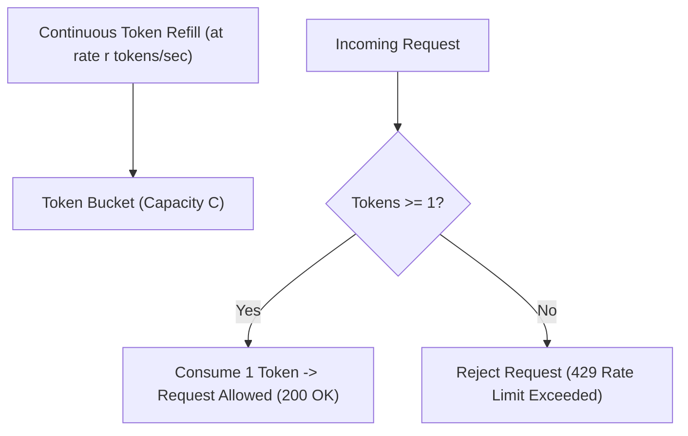

# Track 3: System Design — Low-Level Design (LLD)
## Chapter 4: Complete LLD: Thread-Safe LRU Cache with TTL & Token Bucket Rate Limiter

Data structures under high concurrency are frequently tested in Staff & Senior LLD interviews. Here are production-grade implementations of an **LRU Cache with TTL** and a **Token Bucket Rate Limiter**.

---

### Real-World Production Context
- **Redis LRU**: Redis uses an approximated LRU algorithm rather than a strict linked-list approach to save memory. It samples a small number of keys and evicts the one that was least recently used among the sample.
- **CPU L1/L2 Cache**: Hardware caches use pseudo-LRU algorithms.
- **Stripe / Cloudflare Rate Limiting**: Stripe uses the Token Bucket algorithm (via Redis + Lua) for their API limits. Cloudflare uses sliding window algorithms at edge locations to prevent DDoS.

> 💡 **Interview Tip**
> For LRU Cache, explicitly mention why you need a Doubly Linked List instead of a Singly Linked List (you need $O(1)$ deletion from the middle). For Rate Limiter, mention how you would implement it in a distributed system (e.g., using Redis Lua scripts).

---

### 1. Thread-Safe LRU Cache with TTL

#### Requirements:
1. **$O(1)$ Operations**: `get(key)` and `put(key, value)` must operate in strict $O(1)$ time complexity.
2. **LRU Eviction**: When capacity is exceeded, evict the least recently used item.
3. **Time-To-Live (TTL)**: Keys expire automatically after a specified duration.
4. **Thread Safety**: Concurrent readers and writers must not corrupt data structures.

#### Data Structure Architecture:
- **Doubly Linked List**: Maintains chronological access order. Most recently used node at `head`, least recently used at `tail`. Moving a node takes $O(1)$ pointer manipulations.
- **Hash Map**: Maps `key` $\to$ `Node` reference for $O(1)$ access.

```mermaid
graph LR
    Head[Dummy Head] <--> Node1[Key: A | Val: 100]
    Node1 <--> Node2[Key: B | Val: 200]
    Node2 <--> Node3[Key: C | Val: 300]
    Node3 <--> Tail[Dummy Tail]

    Map[(Hash Map)] -->|Key A| Node1
    Map -->|Key B| Node2
    Map -->|Key C| Node3
```

#### Production Python Implementation:
```python
import time
import threading
from typing import Any, Optional

class Node:
    def __init__(self, key: Any = None, value: Any = None, ttl_seconds: Optional[float] = None):
        self.key = key
        self.value = value
        self.expiry_time = (time.time() + ttl_seconds) if ttl_seconds else None
        self.prev: Optional['Node'] = None
        self.next: Optional['Node'] = None

    def is_expired(self) -> bool:
        return self.expiry_time is not None and time.time() > self.expiry_time

class ThreadSafeLRUCache:
    def __init__(self, capacity: int):
        self.capacity = capacity
        self.cache: dict[Any, Node] = {}
        self.lock = threading.RLock()

        # Sentinel dummy nodes
        self.head = Node()
        self.tail = Node()
        self.head.next = self.tail
        self.tail.prev = self.head

    def _remove(self, node: Node):
        """Detach node from linked list."""
        prev_node = node.prev
        next_node = node.next
        prev_node.next = next_node
        next_node.prev = prev_node

    def _add_to_head(self, node: Node):
        """Insert node right after dummy head (most recently used)."""
        node.next = self.head.next
        node.prev = self.head
        self.head.next.prev = node
        self.head.next = node

    def get(self, key: Any) -> Optional[Any]:
        with self.lock:
            if key not in self.cache:
                return None

            node = self.cache[key]
            # Lazy expiration check
            if node.is_expired():
                self._remove(node)
                del self.cache[key]
                return None

            # Move to head (mark as most recently used)
            self._remove(node)
            self._add_to_head(node)
            return node.value

    def put(self, key: Any, value: Any, ttl_seconds: Optional[float] = None):
        with self.lock:
            if key in self.cache:
                node = self.cache[key]
                node.value = value
                node.expiry_time = (time.time() + ttl_seconds) if ttl_seconds else None
                self._remove(node)
                self._add_to_head(node)
                return

            if len(self.cache) >= self.capacity:
                # Evict least recently used (node before dummy tail)
                lru_node = self.tail.prev
                self._remove(lru_node)
                del self.cache[lru_node.key]

            new_node = Node(key, value, ttl_seconds)
            self.cache[key] = new_node
            self._add_to_head(new_node)
```

#### Production Java 17 Implementation:
```java
import java.util.concurrent.ConcurrentHashMap;
import java.util.concurrent.locks.ReentrantLock;

class LRUCache<K, V> {
    class Node {
        K key; V value;
        Node prev, next;
        Node(K k, V v) { key = k; value = v; }
    }
    
    private final int capacity;
    private final ConcurrentHashMap<K, Node> cache;
    private final Node head, tail;
    private final ReentrantLock lock = new ReentrantLock();

    public LRUCache(int capacity) {
        this.capacity = capacity;
        this.cache = new ConcurrentHashMap<>();
        this.head = new Node(null, null);
        this.tail = new Node(null, null);
        head.next = tail;
        tail.prev = head;
    }

    private void remove(Node node) {
        node.prev.next = node.next;
        node.next.prev = node.prev;
    }

    private void addToHead(Node node) {
        node.next = head.next;
        node.prev = head;
        head.next.prev = node;
        head.next = node;
    }

    public V get(K key) {
        lock.lock();
        try {
            if (!cache.containsKey(key)) return null;
            Node node = cache.get(key);
            remove(node);
            addToHead(node);
            return node.value;
        } finally {
            lock.unlock();
        }
    }

    public void put(K key, V value) {
        lock.lock();
        try {
            if (cache.containsKey(key)) {
                Node node = cache.get(key);
                node.value = value;
                remove(node);
                addToHead(node);
            } else {
                if (cache.size() >= capacity) {
                    Node lru = tail.prev;
                    remove(lru);
                    cache.remove(lru.key);
                }
                Node newNode = new Node(key, value);
                cache.put(key, newNode);
                addToHead(newNode);
            }
        } finally {
            lock.unlock();
        }
    }
}
```

---

### 2. Token Bucket Rate Limiter

The **Token Bucket** algorithm allows bursty traffic up to bucket capacity while enforcing a strict steady-state leak rate.



#### Production Python Implementation:
```python
import time
import threading

class TokenBucketRateLimiter:
    def __init__(self, capacity: int, refill_rate_per_sec: float):
        self.capacity = capacity
        self.refill_rate = refill_rate_per_sec
        self.tokens = float(capacity)
        self.last_refill_time = time.time()
        self.lock = threading.Lock()

    def allow_request(self, tokens_needed: int = 1) -> bool:
        with self.lock:
            now = time.time()
            elapsed = now - self.last_refill_time
            self.last_refill_time = now

            # Replenish tokens based on elapsed time:
            self.tokens = min(float(self.capacity), self.tokens + elapsed * self.refill_rate)

            if self.tokens >= tokens_needed:
                self.tokens -= tokens_needed
                return True
            return False
```

#### Production Java 17 Implementation:
```java
import java.util.concurrent.locks.ReentrantLock;

class TokenBucket {
    private final long capacity;
    private final double refillRate;
    private double tokens;
    private long lastRefillTime;
    private final ReentrantLock lock = new ReentrantLock();

    public TokenBucket(long capacity, double refillRate) {
        this.capacity = capacity;
        this.refillRate = refillRate;
        this.tokens = capacity;
        this.lastRefillTime = System.nanoTime();
    }

    public boolean allowRequest(int tokensNeeded) {
        lock.lock();
        try {
            long now = System.nanoTime();
            double elapsedSec = (now - lastRefillTime) / 1e9;
            lastRefillTime = now;
            
            tokens = Math.min(capacity, tokens + elapsedSec * refillRate);
            
            if (tokens >= tokensNeeded) {
                tokens -= tokensNeeded;
                return true;
            }
            return false;
        } finally {
            lock.unlock();
        }
    }
}
```

---

> 📺 **Video References**
> - NeetCode: LRU Cache (https://www.youtube.com/@NeetCode)
> - ByteByteGo: Rate Limiting System Design (https://www.youtube.com/@ByteByteGo)

> 📖 **Must-Read Resources**
> - Stripe Engineering: Rate Limiters (https://stripe.com/blog/rate-limiters)
> - Redis Documentation: LRU Cache (https://redis.io/topics/lru-cache)
