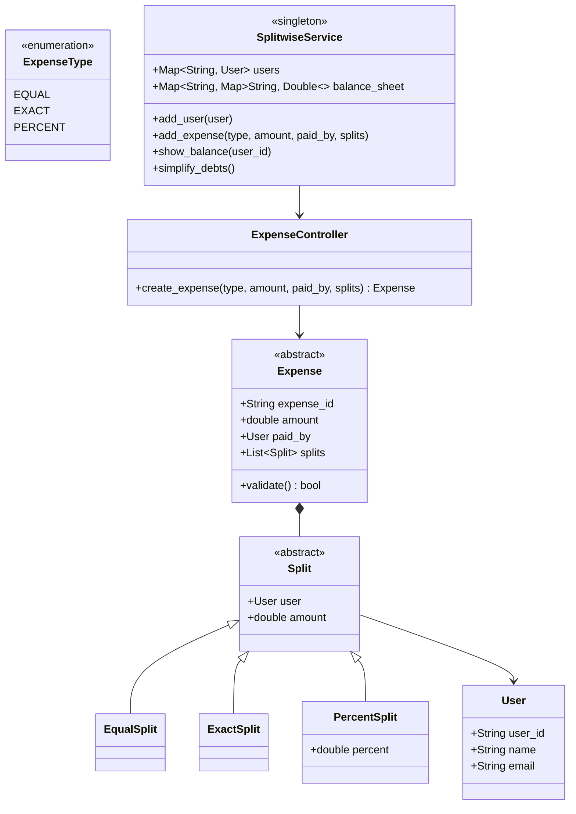

# Track 3: System Design — Low-Level Design (LLD)
## Chapter 5: Complete LLD: Splitwise Expense Sharing System

The Splitwise Low-Level Design problem is one of the most frequently asked machine-coding questions at Tier-1 product-based companies (Uber, Swiggy, Cred, PhonePe, Amazon, Flipkart).

It tests object-oriented modeling, the Strategy Pattern for expense calculations, and graph algorithms for debt simplification.

---

### Real-World Production Context
- **Splitwise Algorithm**: The real Splitwise simplifies debts using network flow algorithms or greedy min-cost flow heuristics. It models the problem as a directed graph where nodes are users and edges are debts. 
- **Payment Integration**: At production scale, this system would integrate with Stripe or PayPal using idempotency keys for payouts.

> 💡 **Interview Tip**
> The core algorithm for debt simplification is a greedy 2-heap approach (Max Heap for creditors, Min Heap for debtors). If you can implement this efficiently, you will ace the interview.

---

### 1. Requirements & Scope

#### Functional Requirements:
1. **User Management**: Register users with `user_id`, `name`, `email`, `phone_number`.
2. **Expense Types**:
   - `EQUAL`: Split equally among participants (handle rounding fractional cents cleanly).
   - `EXACT`: Split by exact dollar amounts (must validate: $\sum \text{exact amounts} == \text{total expense}$).
   - `PERCENT`: Split by percentage (must validate: $\sum \text{percentages} == 100\%$).
3. **Group Management**: Users can create groups and add expenses to groups or individual peer-to-peer expenses.
4. **Balance Sheet**: View balances for a single user ("You owe $X", "You are owed $Y") or global balances.
5. **Debt Simplification (Min-Cash-Flow Algorithm)**: Minimize total number of payment transactions among group members (e.g. if A owes B $10, and B owes C $10, simplify so A pays C $10 directly).

---

### 2. Class Diagram



---

### 3. Production Python Implementation (with Debt Simplification)

```python
from abc import ABC, abstractmethod
from enum import Enum
import heapq

# --- 1. Enums & User ---
class ExpenseType(Enum):
    EQUAL = "EQUAL"
    EXACT = "EXACT"
    PERCENT = "PERCENT"

class User:
    def __init__(self, user_id: str, name: str, email: str):
        self.user_id = user_id
        self.name = name
        self.email = email

# --- 2. Split Hierarchy ---
class Split(ABC):
    def __init__(self, user: User, amount: float = 0.0):
        self.user = user
        self.amount = amount

class EqualSplit(Split):
    pass

class ExactSplit(Split):
    pass

class PercentSplit(Split):
    def __init__(self, user: User, percent: float):
        super().__init__(user)
        self.percent = percent

# --- 3. Expense Validation Strategy ---
class Expense(ABC):
    def __init__(self, expense_id: str, amount: float, paid_by: User, splits: list[Split]):
        self.expense_id = expense_id
        self.amount = amount
        self.paid_by = paid_by
        self.splits = splits

    @abstractmethod
    def validate(self) -> bool:
        pass

class EqualExpense(Expense):
    def validate(self) -> bool:
        return True  # Equal splits are automatically calculated

class ExactExpense(Expense):
    def validate(self) -> bool:
        total_split = sum(s.amount for s in self.splits)
        return abs(total_split - self.amount) < 0.01

class PercentExpense(Expense):
    def validate(self) -> bool:
        total_percent = sum(s.percent for s in self.splits if isinstance(s, PercentSplit))
        return abs(total_percent - 100.0) < 0.01

# --- 4. Splitwise Core Service ---
class SplitwiseService:
    def __init__(self):
        self.users: dict[str, User] = {}
        # balance_sheet[user_A][user_B] = amount user_A owes user_B
        self.balance_sheet: dict[str, dict[str, float]] = {}

    def add_user(self, user: User):
        self.users[user.user_id] = user
        self.balance_sheet[user.user_id] = {}

    def add_expense(self, expense_type: ExpenseType, amount: float, paid_by_id: str, splits: list[Split]):
        paid_by = self.users[paid_by_id]

        if expense_type == ExpenseType.EQUAL:
            num_splits = len(splits)
            split_amount = round(amount / num_splits, 2)
            for split in splits:
                split.amount = split_amount
            # Handle rounding discrepancy on first user
            discrepancy = amount - (split_amount * num_splits)
            splits[0].amount += round(discrepancy, 2)
            expense = EqualExpense("exp_" + str(len(self.balance_sheet)), amount, paid_by, splits)

        elif expense_type == ExpenseType.EXACT:
            expense = ExactExpense("exp_" + str(len(self.balance_sheet)), amount, paid_by, splits)

        elif expense_type == ExpenseType.PERCENT:
            for split in splits:
                if isinstance(split, PercentSplit):
                    split.amount = round(amount * (split.percent / 100.0), 2)
            expense = PercentExpense("exp_" + str(len(self.balance_sheet)), amount, paid_by, splits)

        if not expense.validate():
            raise ValueError("Expense validation failed! Check split amounts or percentages.")

        # Update Balance Sheet
        for split in splits:
            owed_by_id = split.user.user_id
            if owed_by_id == paid_by_id:
                continue

            # owed_by owes paid_by
            current_owed = self.balance_sheet[owed_by_id].get(paid_by_id, 0.0)
            reverse_owed = self.balance_sheet[paid_by_id].get(owed_by_id, 0.0)

            if reverse_owed > 0:
                if reverse_owed >= split.amount:
                    self.balance_sheet[paid_by_id][owed_by_id] -= split.amount
                else:
                    net = split.amount - reverse_owed
                    self.balance_sheet[paid_by_id][owed_by_id] = 0.0
                    self.balance_sheet[owed_by_id][paid_by_id] = current_owed + net
            else:
                self.balance_sheet[owed_by_id][paid_by_id] = current_owed + split.amount

    def show_balances(self):
        has_balance = False
        for user1, balances in self.balance_sheet.items():
            for user2, amount in balances.items():
                if amount > 0.01:
                    has_balance = True
                    u1_name = self.users[user1].name
                    u2_name = self.users[user2].name
                    print(f"{u1_name} owes {u2_name}: ${amount:.2f}")
        if not has_balance:
            print("No outstanding balances!")

    # --- 5. Debt Simplification Algorithm (Min Cash Flow) ---
    def simplify_debts(self):
        """Minimizes transaction count using a greedy 2-heap net-balance algorithm."""
        net_balances = {uid: 0.0 for uid in self.users}

        for u1, balances in self.balance_sheet.items():
            for u2, amount in balances.items():
                net_balances[u1] -= amount  # owes money
                net_balances[u2] += amount  # is owed money

        debtors = []   # Min-heap of (-net_amount, user_id) -> people who owe
        creditors = [] # Min-heap of (-net_amount, user_id) -> people owed

        for uid, net in net_balances.items():
            if net < -0.01:
                heapq.heappush(debtors, (net, uid))
            elif net > 0.01:
                heapq.heappush(creditors, (-net, uid))

        print("\n--- Simplified Settlements ---")
        while debtors and creditors:
            debt_val, debtor_id = heapq.heappop(debtors)
            cred_val, creditor_id = heapq.heappop(creditors)

            debt = -debt_val
            credit = -cred_val
            settle_amount = min(debt, credit)

            d_name = self.users[debtor_id].name
            c_name = self.users[creditor_id].name
            print(f"-> {d_name} pays {c_name}: ${settle_amount:.2f}")

            remaining_debt = debt - settle_amount
            remaining_credit = credit - settle_amount

            if remaining_debt > 0.01:
                heapq.heappush(debtors, (-remaining_debt, debtor_id))
            if remaining_credit > 0.01:
                heapq.heappush(creditors, (-remaining_credit, creditor_id))
```

---

### 4. Production Java 17 Implementation

```java
import java.util.*;

public class SplitwiseDemo {
    public enum ExpenseType { EQUAL, EXACT, PERCENT }

    public static class User {
        public String userId;
        public String name;
        public User(String id, String name) { this.userId = id; this.name = name; }
    }

    public static class Split {
        public User user;
        public double amount;
        public double percent;
        public Split(User user) { this.user = user; }
        public Split(User user, double amount) { this.user = user; this.amount = amount; }
    }

    public static class SplitwiseService {
        private final Map<String, User> users = new HashMap<>();
        // balanceSheet[userA][userB] = amount userA owes userB
        private final Map<String, Map<String, Double>> balanceSheet = new HashMap<>();

        public void addUser(User user) {
            users.put(user.userId, user);
            balanceSheet.put(user.userId, new HashMap<>());
        }

        public void addExpense(ExpenseType type, double totalAmount, String paidById, List<Split> splits) {
            if (type == ExpenseType.EQUAL) {
                double splitAmount = Math.round((totalAmount / splits.size()) * 100.0) / 100.0;
                for (Split s : splits) s.amount = splitAmount;
            } else if (type == ExpenseType.PERCENT) {
                for (Split s : splits) {
                    s.amount = Math.round(totalAmount * (s.percent / 100.0) * 100.0) / 100.0;
                }
            }

            for (Split split : splits) {
                String owedById = split.user.userId;
                if (owedById.equals(paidById)) continue;

                double currentOwed = balanceSheet.get(owedById).getOrDefault(paidById, 0.0);
                balanceSheet.get(owedById).put(paidById, currentOwed + split.amount);
            }
        }

        public void showBalances() {
            boolean hasBalance = false;
            for (var entry : balanceSheet.entrySet()) {
                String u1 = entry.getKey();
                for (var inner : entry.getValue().entrySet()) {
                    String u2 = inner.getKey();
                    double amount = inner.getValue();
                    if (amount > 0.01) {
                        hasBalance = true;
                        System.out.printf("%s owes %s: $%.2f%n", users.get(u1).name, users.get(u2).name, amount);
                    }
                }
            }
            if (!hasBalance) System.out.println("No outstanding balances!");
        }
    }
}
```

---

> 📺 **Video References**
> - Concept&Coding: Splitwise LLD (https://www.youtube.com/@ConceptAndCoding)
> - Gaurav Sen: Splitwise System Design (https://www.youtube.com/@GauravSensei)

> 📖 **Must-Read Resources**
> - Splitwise Engineering Blog: Debt Simplification (https://blog.splitwise.com)
> - GeeksForGeeks: Minimize Cash Flow among friends (https://www.geeksforgeeks.org/minimize-cash-flow-among-given-set-friends-borrowed-money/)
