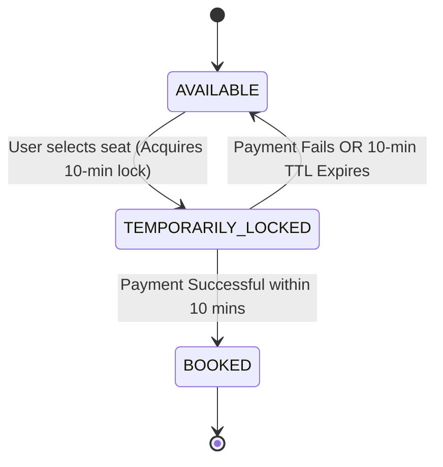
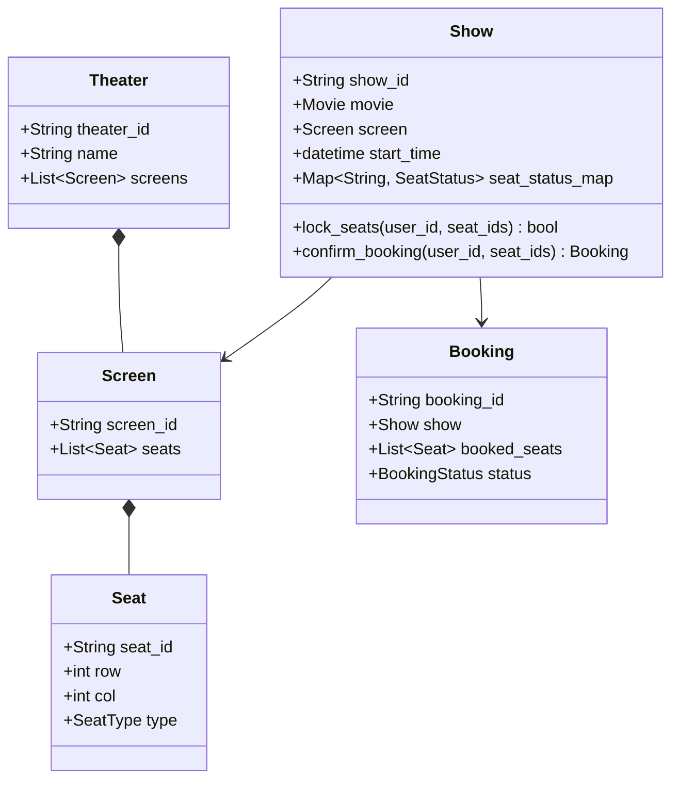

# Track 3: System Design — Low-Level Design (LLD)
## Chapter 6: Complete LLD: Movie Ticket Booking System (BookMyShow)

The Movie Ticket Booking System is a signature machine-coding problem at Amazon, Walmart, Flipkart, and Swiggy. It evaluates multi-entity domain modeling and **high-concurrency seat locking with time-to-live (TTL) expiration**.

---

### Real-World Production Context
- **BookMyShow / Ticketmaster**: Real ticket systems heavily use **Redis Distributed Locks (Redlock)** for temporarily holding seats. A background Kafka consumer with a DLQ usually handles lock expirations.
- **Isolation Levels**: Relational databases (like PostgreSQL) are typically used for the booking transaction with `SELECT ... FOR UPDATE` row-level locks or `SERIALIZABLE` isolation to guarantee no double-booking at checkout.

> 💡 **Interview Tip**
> Ensure you highlight the **Race Condition**. Two users fetching seat status concurrently will both see it as 'Available'. Using a ReentrantLock (in Java) or threading.RLock (in Python) at the `Show` level is essential. For HLD discussions, mention Redis.

---

### 1. Requirements & Core Challenge

#### The Double-Booking Race Condition:
Two users select the exact same seat (`Seat C12`) at the same second. If both reach checkout, one user will be charged for an unavailable seat.
- **Solution**: A 3-state seat lifecycle:
  `AVAILABLE` $\to$ `TEMPORARILY_LOCKED` (Held for 10 minutes) $\to$ `BOOKED` (Upon payment success) or `AVAILABLE` (Upon payment timeout / failure).



---

### 2. Class Diagram



---

### 3. Production Python Implementation (Thread-Safe Seat Locking)

```python
import time
import threading
import uuid
from enum import Enum
from typing import Optional

class SeatType(Enum):
    SILVER = 150.0
    GOLD = 250.0
    PLATINUM = 400.0

class SeatStatus(Enum):
    AVAILABLE = "AVAILABLE"
    LOCKED = "LOCKED"
    BOOKED = "BOOKED"

class Seat:
    def __init__(self, seat_id: str, row: int, col: int, seat_type: SeatType):
        self.seat_id = seat_id
        self.row = row
        self.col = col
        self.seat_type = seat_type

class SeatLock:
    def __init__(self, seat_id: str, locked_by_user_id: str, timeout_seconds: float = 600.0):
        self.seat_id = seat_id
        self.locked_by = locked_by_user_id
        self.lock_expiry = time.time() + timeout_seconds

    def is_expired(self) -> bool:
        return time.time() > self.lock_expiry

class Show:
    def __init__(self, show_id: str, movie_title: str, seats: list[Seat]):
        self.show_id = show_id
        self.movie_title = movie_title
        self.seats = {s.seat_id: s for s in seats}
        self.seat_status: dict[str, SeatStatus] = {s.seat_id: SeatStatus.AVAILABLE for s in seats}
        self.active_locks: dict[str, SeatLock] = {}
        self._lock = threading.RLock()

    def lock_seats(self, user_id: str, seat_ids: list[str], timeout_seconds: float = 600.0) -> bool:
        with self._lock:
            # 1. Clean up expired locks first
            now = time.time()
            for s_id, s_lock in list(self.active_locks.items()):
                if s_lock.is_expired():
                    del self.active_locks[s_id]
                    self.seat_status[s_id] = SeatStatus.AVAILABLE

            # 2. Check if all requested seats are available
            for s_id in seat_ids:
                if self.seat_status[s_id] != SeatStatus.AVAILABLE:
                    return False  # At least one seat is already locked or booked!

            # 3. Atomically lock all seats
            for s_id in seat_ids:
                self.seat_status[s_id] = SeatStatus.LOCKED
                self.active_locks[s_id] = SeatLock(s_id, user_id, timeout_seconds)

            print(f"[{user_id}] Successfully locked seats: {seat_ids} for {timeout_seconds}s")
            return True

    def confirm_booking(self, user_id: str, seat_ids: list[str]) -> bool:
        with self._lock:
            # Verify user holds valid, unexpired locks for all seats
            for s_id in seat_ids:
                lock = self.active_locks.get(s_id)
                if not lock or lock.locked_by != user_id or lock.is_expired():
                    print(f"[{user_id}] Cannot book: Lock expired or not owned for {s_id}")
                    return False

            # Mark permanently booked
            for s_id in seat_ids:
                self.seat_status[s_id] = SeatStatus.BOOKED
                del self.active_locks[s_id]

            total_amount = sum(self.seats[s_id].seat_type.value for s_id in seat_ids)
            print(f"[{user_id}] BOOKING CONFIRMED! Seats: {seat_ids} | Total Paid: ${total_amount:.2f}")
            return True
```

---

### 4. Production Java 17 Implementation

```java
import java.util.*;
import java.util.concurrent.locks.ReentrantLock;

public class BookMyShowDemo {
    public enum SeatType {
        SILVER(150.0), GOLD(250.0), PLATINUM(400.0);
        public final double price;
        SeatType(double price) { this.price = price; }
    }

    public enum SeatStatus { AVAILABLE, LOCKED, BOOKED }

    public static class Seat {
        public String seatId;
        public SeatType type;
        public Seat(String id, SeatType type) { this.seatId = id; this.type = type; }
    }

    public static class Show {
        public String showId;
        public String movieTitle;
        private final Map<String, Seat> seats = new HashMap<>();
        private final Map<String, SeatStatus> seatStatus = new HashMap<>();
        private final Map<String, Long> lockExpiryMap = new HashMap<>();
        private final Map<String, String> lockedByUserMap = new HashMap<>();
        private final ReentrantLock lock = new ReentrantLock();

        public Show(String showId, String movieTitle, List<Seat> seatList) {
            this.showId = showId;
            this.movieTitle = movieTitle;
            for (Seat s : seatList) {
                seats.put(s.seatId, s);
                seatStatus.put(s.seatId, SeatStatus.AVAILABLE);
            }
        }

        public boolean lockSeats(String userId, List<String> seatIds, long timeoutMs) {
            lock.lock();
            try {
                long now = System.currentTimeMillis();
                // Clean expired locks
                for (String sId : new ArrayList<>(lockExpiryMap.keySet())) {
                    if (now > lockExpiryMap.get(sId)) {
                        lockExpiryMap.remove(sId);
                        lockedByUserMap.remove(sId);
                        seatStatus.put(sId, SeatStatus.AVAILABLE);
                    }
                }

                // Verify availability
                for (String sId : seatIds) {
                    if (seatStatus.get(sId) != SeatStatus.AVAILABLE) {
                        return false;
                    }
                }

                // Lock seats atomically
                for (String sId : seatIds) {
                    seatStatus.put(sId, SeatStatus.LOCKED);
                    lockExpiryMap.put(sId, now + timeoutMs);
                    lockedByUserMap.put(sId, userId);
                }
                return true;
            } finally {
                lock.unlock();
            }
        }

        public boolean confirmBooking(String userId, List<String> seatIds) {
            lock.lock();
            try {
                long now = System.currentTimeMillis();
                for (String sId : seatIds) {
                    if (!userId.equals(lockedByUserMap.get(sId)) || now > lockExpiryMap.getOrDefault(sId, 0L)) {
                        return false;
                    }
                }

                for (String sId : seatIds) {
                    seatStatus.put(sId, SeatStatus.BOOKED);
                    lockExpiryMap.remove(sId);
                    lockedByUserMap.remove(sId);
                }
                return true;
            } finally {
                lock.unlock();
            }
        }
    }
}
```

---

> 📺 **Video References**
> - Concept&Coding: LLD of BookMyShow (https://www.youtube.com/@ConceptAndCoding)
> - ByteByteGo: Ticketmaster System Design (https://www.youtube.com/@ByteByteGo)

> 📖 **Must-Read Resources**
> - High Scalability: BookMyShow Architecture (http://highscalability.com)
> - PostgreSQL Docs: Explicit Locking (https://www.postgresql.org/docs/current/explicit-locking.html)
