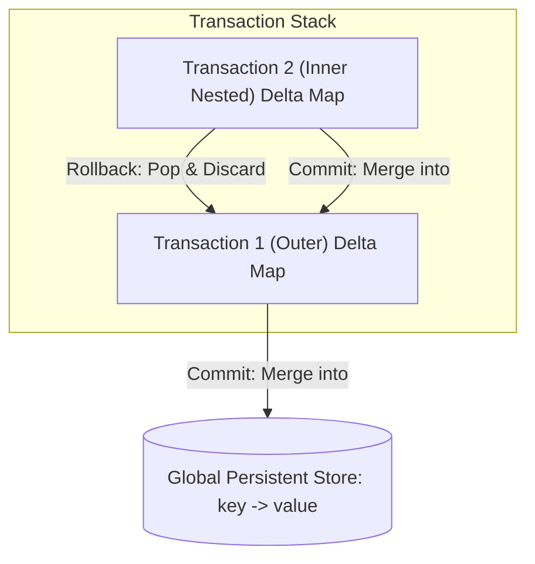

# Track 3: System Design — Low-Level Design (LLD)
## Chapter 7: Complete LLD: In-Memory Transactional Key-Value Store

Designing an In-Memory Key-Value Store with full **ACID Transaction Support** (`BEGIN`, `COMMIT`, `ROLLBACK`, including **Nested Transactions**) is a classic machine coding and systems interview question at Apple, Databricks, Stripe, and Microsoft.

---

### Real-World Production Context
- **Redis MULTI/EXEC**: Redis executes transaction blocks sequentially as a single isolated operation. It does not support nested transactions but supports optimistic locking via `WATCH`.
- **etcd (Kubernetes)**: etcd uses transactions for compare-and-swap (CAS) operations to ensure atomic updates to cluster states.

> 💡 **Interview Tip**
> The most elegant way to handle nested transactions is using a Stack of Maps (or Deque of HashMaps in Java). Do not copy the entire global store on every `BEGIN`—that is an $O(N)$ memory violation. Only store the deltas (changes) in the stack.

---

### 1. Requirements & Architecture

#### Functional Requirements:
1. **Core Operations**:
   - `get(key)`: Retrieves value in $O(1)$.
   - `set(key, val)`: Stores value in $O(1)$.
   - `delete(key)`: Removes key.
2. **Transaction Mechanics**:
   - `begin()`: Opens a new transaction scope.
   - `commit()`: Atomically commits changes from the active transaction into the parent scope (or global store).
   - `rollback()`: Undoes all changes in the active transaction scope.
   - **Nested Transactions**: Transactions can be stacked indefinitely (`BEGIN` $\to$ `BEGIN` $\to$ `ROLLBACK` $\to$ `COMMIT`).



---

### 2. Production Python Implementation (with Nested Transactions)

```python
from typing import Optional

class TransactionalKeyValueStore:
    def __init__(self):
        # Global committed store
        self.global_store: dict[str, str] = {}
        # Stack of active transaction delta dictionaries
        # None represents a key marked for deletion in that transaction scope
        self.transaction_stack: list[dict[str, Optional[str]]] = []

    def begin(self):
        """Opens a new transaction context."""
        self.transaction_stack.append({})
        print("--> Transaction Started (Depth: {})".format(len(self.transaction_stack)))

    def get(self, key: str) -> Optional[str]:
        # Traverse transaction stack from innermost to outermost
        for tx in reversed(self.transaction_stack):
            if key in tx:
                return tx[key]  # May be None if deleted

        return self.global_store.get(key)

    def set(self, key: str, value: str):
        if self.transaction_stack:
            # Stage write inside active transaction
            self.transaction_stack[-1][key] = value
        else:
            self.global_store[key] = value

    def delete(self, key: str):
        if self.transaction_stack:
            # Mark as deleted using None sentinel in active transaction
            self.transaction_stack[-1][key] = None
        else:
            self.global_store.pop(key, None)

    def commit(self) -> bool:
        if not self.transaction_stack:
            print("Error: No active transaction to commit.")
            return False

        active_tx = self.transaction_stack.pop()

        if self.transaction_stack:
            # Merge into parent transaction
            self.transaction_stack[-1].update(active_tx)
            print("--> Transaction Merged into Parent (Depth: {})".format(len(self.transaction_stack)))
        else:
            # Apply directly to global store
            for key, val in active_tx.items():
                if val is None:
                    self.global_store.pop(key, None)
                else:
                    self.global_store[key] = val
            print("--> Transaction COMMITTED Globally!")
        return True

    def rollback(self) -> bool:
        if not self.transaction_stack:
            print("Error: No active transaction to rollback.")
            return False

        self.transaction_stack.pop()
        print("--> Transaction ROLLED BACK! (Depth: {})".format(len(self.transaction_stack)))
        return True
```

---

### 3. Production Java 17 Implementation

```java
import java.util.*;

public class TransactionalKVStore {
    private final Map<String, String> globalStore = new HashMap<>();
    private final Deque<Map<String, String>> transactionStack = new ArrayDeque<>();
    private static final String TOMBSTONE = "__DELETED_TOMBSTONE__";

    public void begin() {
        transactionStack.push(new HashMap<>());
    }

    public String get(String key) {
        for (Map<String, String> tx : transactionStack) {
            if (tx.containsKey(key)) {
                String val = tx.get(key);
                return TOMBSTONE.equals(val) ? null : val;
            }
        }
        return globalStore.get(key);
    }

    public void set(String key, String value) {
        if (!transactionStack.isEmpty()) {
            transactionStack.peek().put(key, value);
        } else {
            globalStore.put(key, value);
        }
    }

    public void delete(String key) {
        if (!transactionStack.isEmpty()) {
            transactionStack.peek().put(key, TOMBSTONE);
        } else {
            globalStore.remove(key);
        }
    }

    public boolean commit() {
        if (transactionStack.isEmpty()) return false;

        Map<String, String> activeTx = transactionStack.pop();
        if (!transactionStack.isEmpty()) {
            transactionStack.peek().putAll(activeTx);
        } else {
            for (var entry : activeTx.entrySet()) {
                if (TOMBSTONE.equals(entry.getValue())) {
                    globalStore.remove(entry.getKey());
                } else {
                    globalStore.put(entry.getKey(), entry.getValue());
                }
            }
        }
        return true;
    }

    public boolean rollback() {
        if (transactionStack.isEmpty()) return false;
        transactionStack.pop();
        return true;
    }
}
```

---

> 📺 **Video References**
> - Concept&Coding: In-Memory KV Store LLD (https://www.youtube.com/@ConceptAndCoding)
> - NeetCode: Design Key-Value Store (https://www.youtube.com/@NeetCode)

> 📖 **Must-Read Resources**
> - Redis Transactions: https://redis.io/docs/interact/transactions/
> - etcd Documentation: https://etcd.io/docs/
