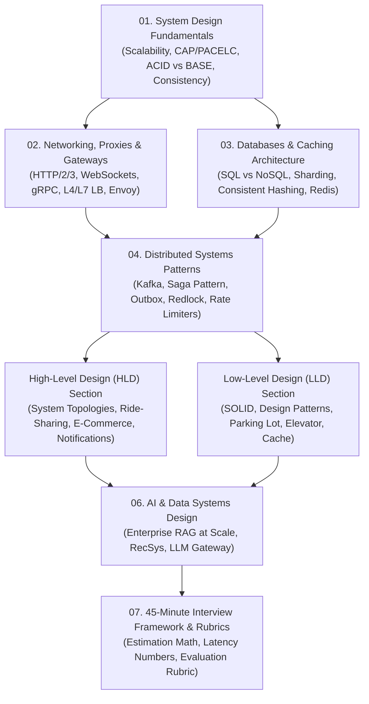

# 🏗️ Distributed System Design: Master Roadmap & Blueprint

Welcome to the **System Design Track**. In Senior, Lead, and Staff engineering interviews, System Design carries the highest weighting. This track equips you with core architectural primitives, distributed systems theory, networking protocols, database scaling strategies, end-to-end High-Level Design (HLD), and object-oriented Low-Level Design (LLD).

---

## 🗺️ Master Curriculum Blueprint

### Real-World Production Context
- **Netflix / Uber / Meta**: These architectural blueprints power the core of modern tech giants. Understanding when to apply which blueprint is critical for staff+ interviews.

> 💡 **Interview Tip**
> The roadmap is your guide. In an actual interview, focus on driving the discussion using these components.

---

---

## 📚 Detailed Chapter Index

### Part 1: Core Distributed Systems Theory
1. **[01-system-design-fundamentals.md](file:///D:/Projects/interview-material/system%20design/01-system-design-fundamentals.md)**
   - Horizontal vs Vertical scaling trade-offs
   - Latency, Throughput, Bandwidth, Availability (99.9% vs 99.999% downtime calculations)
   - CAP Theorem & PACELC Theorem deep dive
   - ACID vs BASE guarantees; Consistency Models (Strong, Eventual, Read-Your-Writes, Causal)

2. **[02-networking-and-proxies.md](file:///D:/Projects/interview-material/system%20design/02-networking-and-proxies.md)**
   - Network protocols: TCP vs UDP, HTTP/1.1 vs HTTP/2 vs HTTP/3 (QUIC)
   - Real-time communication: WebSockets vs Server-Sent Events (SSE) vs Long-Polling
   - RPC: gRPC (HTTP/2, Protobuf, Multiplexing) vs REST
   - Load Balancing: Layer 4 vs Layer 7, algorithms (Least Connections, Consistent Hashing)
   - Reverse Proxies (Nginx, Envoy) & API Gateways (Authentication, SSL Termination, Rate Limiting)

3. **[03-databases-and-caching.md](file:///D:/Projects/interview-material/system%20design/03-databases-and-caching.md)**
   - Relational (PostgreSQL, MySQL) vs NoSQL (Document, Key-Value, Wide-Column, Graph)
   - Database Scaling: Read Replicas, Replication Lag, Sharding Strategies (Range, Hash, Directory)
   - Consistent Hashing: Virtual nodes, ring topology, rebalancing mechanics
   - Caching Strategies: Cache-Aside, Write-Through, Write-Behind (Write-Back), Refresh-Ahead
   - Cache Eviction: LRU, LFU, FIFO; Mitigating Cache Stampede, Avalanche, and Penetration
   - Redis Internals: Single-threaded event loop, data structures, persistence (RDB + AOF)

4. **[04-distributed-patterns.md](file:///D:/Projects/interview-material/system%20design/04-distributed-patterns.md)**
   - Message Queues (RabbitMQ, SQS) vs Distributed Event Logs (Apache Kafka)
   - Kafka Internals: Topics, Partitions, Consumer Groups, Offsets, Exactly-Once Semantics (EOS)
   - Distributed Transactions: Two-Phase Commit (2PC) vs Saga Pattern (Choreography vs Orchestration)
   - Reliability Patterns: Transactional Outbox Pattern with Change Data Capture (CDC / Debezium)
   - Distributed Locking: Redis Redlock vs ZooKeeper/etcd, Fencing tokens
   - Rate Limiting Algorithms: Token Bucket, Leaky Bucket, Sliding Window Counter

5. **[05-classic-case-studies.md](file:///D:/Projects/interview-material/system%20design/05-classic-case-studies.md)**
   - **Case 1: URL Shortener (TinyURL)** (Base62 encoding, Snowflake ID generation, Caching, 100M daily clicks)
   - **Case 2: Real-Time Chat System (WhatsApp / Slack)** (WebSockets, Connection Managers, Presence Server, Message Ordering)
   - **Case 3: High-Concurrency Flash Sale / Inventory** (Overselling prevention, Redis Lua scripts, Queue buffering, Optimistic locking)
   - **Case 4: Distributed Task Queue (Celery / BullMQ architecture)** (Task brokers, worker state machines, retries, dead-letter queues)

---

### Part 2: High-Level Design (HLD) Deep Dives (`hld/`)
- **[hld/01-hld-framework-and-components.md](file:///D:/Projects/interview-material/system%20design/hld/01-hld-framework-and-components.md)**: 6-step HLD methodology, layered component topology, and monolithic vs microservices decision matrices.
- **[hld/02-ride-sharing-uber-lyft.md](file:///D:/Projects/interview-material/system%20design/hld/02-ride-sharing-uber-lyft.md)**: Complete HLD of Uber/Lyft: 250k writes/sec GPS ingestion, Uber H3 hexagonal spatial indexing, and driver matching.
- **[hld/03-ecommerce-marketplace-amazon.md](file:///D:/Projects/interview-material/system%20design/hld/03-ecommerce-marketplace-amazon.md)**: Complete HLD of Amazon/Flipkart: Search sync with CDC, distributed shopping carts, and Saga checkout orchestrator.
- **[hld/04-scalable-notification-system.md](file:///D:/Projects/interview-material/system%20design/hld/04-scalable-notification-system.md)**: Multi-channel platform (APNs, FCM, SMS, Email), priority queues, template engines, and deduplication.

---

### Part 3: Low-Level Design (LLD) & Machine Coding (`lld/`)
- **[lld/01-lld-principles-and-design-patterns.md](file:///D:/Projects/interview-material/system%20design/lld/01-lld-principles-and-design-patterns.md)**: SOLID principles with code refactorings, GoF patterns (Strategy, Observer, Factory, Decorator, State).
- **[lld/02-parking-lot-system.md](file:///D:/Projects/interview-material/system%20design/lld/02-parking-lot-system.md)**: Multi-floor parking lot with vehicle compatibility, thread-safe spot locking, and dynamic pricing strategies.
- **[lld/03-elevator-system.md](file:///D:/Projects/interview-material/system%20design/lld/03-elevator-system.md)**: Multi-car elevator bank with LOOK/SCAN dispatch scheduling algorithm and state machine transitions.
- **[lld/04-lru-cache-and-rate-limiter.md](file:///D:/Projects/interview-material/system%20design/lld/04-lru-cache-and-rate-limiter.md)**: Thread-safe $O(1)$ LRU Cache with TTL using Doubly Linked List + Hash Map, and Token Bucket rate limiter.
- **[lld/05-splitwise-expense-sharing.md](file:///D:/Projects/interview-material/system%20design/lld/05-splitwise-expense-sharing.md)**: Debt simplification using Graph theory and min-cash-flow algorithms.
- **[lld/06-movie-ticket-booking-bookmyshow.md](file:///D:/Projects/interview-material/system%20design/lld/06-movie-ticket-booking-bookmyshow.md)**: Handling high concurrency and race conditions with distributed locks.
- **[lld/07-in-memory-key-value-store.md](file:///D:/Projects/interview-material/system%20design/lld/07-in-memory-key-value-store.md)**: Nested transaction mechanics (`BEGIN`, `COMMIT`, `ROLLBACK`).

---

### Part 4: AI Systems Design & Framework
6. **[06-ai-system-design.md](file:///D:/Projects/interview-material/system%20design/06-ai-system-design.md)**
   - **Design 1: Enterprise RAG Platform at Scale** (Multi-tenant isolation, hybrid vector search, semantic caching, < 800ms P95 latency)
   - **Design 2: Real-Time Multimodal Recommendation Engine** (Two-stage candidate generation, online Redis feature store)
   - **Design 3: Resilient LLM Gateway / Proxy** (Multi-provider failover, quota management, semantic caching, streaming token buffering)

7. **[07-interview-framework-and-rubrics.md](file:///D:/Projects/interview-material/system%20design/07-interview-framework-and-rubrics.md)**
   - The 4-Step 45-Minute System Design Interview Execution Plan
   - System Design Cheat Sheet: Numbers Every Systems Engineer Must Know (Latencies, throughputs, storage multipliers)
   - Senior / Staff Evaluation Rubric used by FAANG & Top Tier Companies

---

> 📺 **Video References**
> - ByteByteGo: System Design Roadmap (https://www.youtube.com/@ByteByteGo)
> - Martin Kleppmann Cambridge: Distributed Systems (https://www.youtube.com/playlist?list=PLeKd45zvjcDFUEv_ohr_HdUFe97RIt8b)

> 📖 **Must-Read Resources**
> - The System Design Primer: https://github.com/donnemartin/system-design-primer
> - AWS Architecture Blog: https://aws.amazon.com/blogs/architecture/
